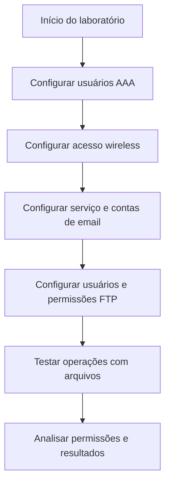

# Laboratório Cisco Networking Academy: Controle de Acesso com AAA, Email e FTP

## Visão geral

Neste laboratório educacional, utilizei o Cisco Packet Tracer para estudar como a autenticação identifica usuários e como a autorização define o que cada pessoa pode fazer em uma rede. A atividade envolveu acesso wireless com AAA/RADIUS, contas de email e permissões de arquivos em um servidor FTP.


---

## Objetivos

- Entender a diferença entre autenticação e autorização.
- Configurar contas de acesso à rede wireless com AAA/RADIUS.
- Configurar contas e serviços de email SMTP e POP3.
- Definir permissões diferentes para usuários de FTP.
- Observar o comportamento de comandos FTP permitidos e negados.

---

## Configurações por dispositivo

### Servidor AAA/RADIUS

| Parâmetro | Configuração observada |
|---|---|
| Serviço AAA | Ativado |
| Protocolo | RADIUS |
| Porta | 1812 |
| Cliente cadastrado | WLC-1 |
| IP do cliente | 192.168.99.250 |
| Contas de usuários | user1 e user2 |

As contas são usadas para autenticar dispositivos na rede wireless. As senhas do exercício foram omitidas da documentação pública.

---

### HQ-Laptop-1

| Parâmetro | Configuração observada |
|---|---|
| Interface | Wireless0 |
| SSID | HQ-INT |
| Autenticação | WPA2 (802.1X) |
| Usuário | user1 |
| Criptografia | AES |
| Endereçamento | DHCP selecionado |
| Rede prevista na atividade | 192.168.50.0/24 |

O uso de WPA2 com 802.1X permite autenticar o usuário com credenciais individuais, em vez de depender apenas de uma senha compartilhada para toda a rede.

---

### HQ-Laptop-2

| Parâmetro | Configuração prevista no exercício |
|---|---|
| SSID | HQ-INT |
| Autenticação | WPA2 com credenciais AAA |
| Usuário | user2 |
| Endereçamento | DHCP |
| Rede esperada | 192.168.50.0/24 |

---

### Servidor de email

| Parâmetro | Configuração observada |
|---|---|
| SMTP | Ativado |
| POP3 | Ativado |
| Domínio | mail.cyberhq.com |
| Contas | HQuser1, HQuser2, BRuser1 e BRuser2 |

O SMTP é usado para enviar mensagens; o POP3 permite recebê-las pelo cliente de email.

---

### Contas de email do exercício

| Usuário | Endereço | Dispositivo indicado na atividade |
|---|---|---|
| HQuser1 | HQuser1@mail.cyberhq.com | PC 1-1 |
| HQuser2 | HQuser2@mail.cyberhq.com | Conforme atividade |
| BRuser1 | BRuser1@mail.cyberhq.com | Conforme atividade |
| BRuser2 | BRuser2@mail.cyberhq.com | Conforme atividade |

A atividade também utiliza os computadores 2-3, HQ-Laptop-1 e Net-Admin para configurar clientes de e-mail. As contas e os dispositivos não foram associados individualmente aqui quando a evidência não permitiu essa confirmação.

---

### Servidor FTP

| Parâmetro | Configuração observada |
|---|---|
| Serviço | FTP ativado |
| Endereço IP utilizado no exercício | 192.168.75.2 |
| Usuários | sukyi, ajulo e malia |

| Usuário | Ler | Escrever | Excluir | Renomear | Listar |
|---|---|---|---|---|---|
| sukyi | Sim | Sim | Sim | Sim | Sim |
| ajulo | Sim | Sim | Sim | Sim | Sim |
| malia | Sim | Sim | Não | Sim | Sim |

A conta `malia` foi configurada sem permissão para excluir arquivos, demonstrando que usuários autenticados podem ter níveis diferentes de autorização.

---

## Etapas do laboratório

1. Ativação do serviço AAA/RADIUS e cadastro de contas de usuários.
2. Configuração de autenticação WPA2/802.1X nos laptops e seleção de DHCP.
3. Ativação de SMTP e POP3 e criação das caixas de email.
4. Configuração de clientes de email e preparação de mensagens.
5. Ativação do FTP e definição de permissões por usuário.
6. Utilização de comandos FTP para acessar arquivos e observar restrições.

---

## Fluxograma do processo



## Comandos FTP utilizados

```text
ftp 192.168.75.2
dir
get aMessage.txt
put aMessage_new.txt
delete aMessage_new.txt
rename aMessage_new.txt aMessage_rename.txt
```

---

## Resultados observados

| Verificação | Observação |
|---|---|
| Acesso ao servidor FTP | Conexão e autenticação apresentadas no terminal |
| Exclusão com `malia` | Negada por falta de permissão |
| Renomeação com `malia` | Concluída com sucesso |
| E-mail | Tela de composição de mensagem registrada; entrega não confirmada pela captura |
| Wireless | Configuração de autenticação e DHCP registrada; conectividade final não comprovada pela captura |

A captura do terminal também registra um timeout em uma tentativa inicial de FTP. Não há evidência suficiente para atribuir uma causa específica.

---

## Conhecimentos adquiridos

O laboratório ajudou a entender que **autenticação** confirma quem está tentando acessar um recurso, enquanto **autorização** determina o que essa pessoa pode fazer depois de entrar.

Na prática, essa diferença é importante para o trabalho com suporte de TI e IAM: uma conta pode estar funcionando corretamente, mas ainda assim não ter permissão para determinada ação. Também pratiquei conceitos de autenticação centralizada, acesso wireless, serviços de e-mail e gerenciamento de permissões em arquivos.


