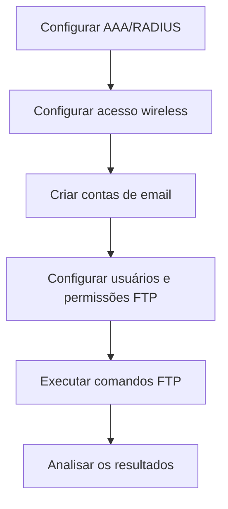

# Controle de Acesso com AAA, Email e FTP

## Visão geral

Neste laboratório da **Cisco Networking Academy (NetAcad)**, utilizei o **Cisco Packet Tracer** para estudar como controlar o acesso de usuários a uma rede wireless, contas de email e arquivos compartilhados.

A atividade envolveu autenticação com AAA/RADIUS, configuração de serviços de email e definição de permissões em um servidor FTP.

O principal aprendizado foi entender que **conseguir acessar um sistema não significa ter permissão para realizar todas as ações**.


---

## Objetivos

- Entender a diferença entre autenticação e autorização.
- Configurar usuários para acessar uma rede wireless com AAA/RADIUS.
- Conhecer os serviços de envio e recebimento de email.
- Definir permissões diferentes para usuários de FTP.
- Identificar operações permitidas e bloqueadas conforme as permissões.


---

## Configurações do laboratório

### 1. Servidor AAA/RADIUS

Responsável por verificar as credenciais dos usuários que tentam acessar a rede wireless.

| Parâmetro | Configuração |
|---|---|
| Serviço AAA | Ativado |
| Protocolo | RADIUS |
| Porta | `1812` |
| Cliente cadastrado | `WLC-1` |
| IP do cliente | `192.168.99.250` |
| Usuários cadastrados | `user1` e `user2` |

---

### 2. Rede wireless e laptops

Os laptops utilizam a rede `HQ-INT`, com autenticação de usuários pelo servidor AAA/RADIUS.

| Parâmetro | Configuração |
|---|---|
| SSID | `HQ-INT` |
| Autenticação | WPA2/802.1X |
| Criptografia registrada | AES |
| Endereçamento | DHCP |
| Rede prevista | `192.168.50.0/24` |

---

**Usuários dos dispositivos:**

| Dispositivo | Usuário | Situação |
|---|---|---|
| HQ-Laptop-1 | `user1` | Configuração registrada |
| HQ-Laptop-2 | `user2` | Configuração prevista na atividade |

A autenticação permite verificar as credenciais antes de autorizar o acesso à rede. O material registra as configurações, mas não confirma a conectividade final dos laptops.

---

### 3. Servidor de email

O servidor utiliza SMTP para envio de mensagens e POP3 para recuperação de emails.

| Parâmetro | Configuração |
|---|---|
| SMTP | Ativado |
| POP3 | Ativado |
| Domínio | `mail.cyberhq.com` |

---

**Contas de email:**

| Usuário | Endereço de email |
|---|---|
| HQuser1 | `HQuser1@mail.cyberhq.com` |
| HQuser2 | `HQuser2@mail.cyberhq.com` |
| BRuser1 | `BRuser1@mail.cyberhq.com` |
| BRuser2 | `BRuser2@mail.cyberhq.com` |

A configuração dos clientes de email envolveu dispositivos como `PC 1-1`, `PC 2-3`, `HQ-Laptop-1` e `Net-Admin`. A conta HQuser1 foi indicada para o PC 1-1.

---

### 4. Servidor FTP e permissões

O FTP permite transferir arquivos entre computadores e um servidor. Cada usuário recebe permissões que definem quais operações pode realizar.

| Parâmetro | Configuração |
|---|---|
| Serviço | FTP ativado |
| Endereço IP | `192.168.75.2` |
| Usuários | `sukyi`, `ajulo` e `malia` |

---

**Permissões configuradas:**

| Usuário | Ler | Escrever | Excluir | Renomear | Listar |
|---|---|---|---|---|---|
| `sukyi` | Sim | Sim | Sim | Sim | Sim |
| `ajulo` | Sim | Sim | Sim | Sim | Sim |
| `malia` | Sim | Sim | Não | Sim | Sim |

**Exemplo:** a conta `malia` pode acessar, enviar e renomear arquivos, mas não possui autorização para excluí-los.

---

## Etapas do laboratório

1. **Autenticação:** ativar o AAA/RADIUS e cadastrar os usuários.
2. **Rede wireless:** configurar os laptops com WPA2/802.1X e DHCP.
3. **Email:** ativar SMTP e POP3, criar contas e preparar mensagens.
4. **FTP:** ativar o serviço e definir as permissões dos usuários.
5. **Verificação:** executar comandos FTP e observar as operações permitidas e negadas.

---

### Fluxo das atividades



---

## Comandos FTP utilizados

Os comandos abaixo foram utilizados para acessar o servidor e trabalhar com arquivos.

```text
ftp 192.168.75.2
dir
get aMessage.txt
put aMessage_new.txt
delete aMessage_new.txt
rename aMessage_new.txt aMessage_rename.txt
```

---

| Comando | Função |
|---|---|
| `ftp` | Conecta ao servidor FTP. |
| `dir` | Lista os arquivos disponíveis. |
| `get` | Baixa um arquivo do servidor. |
| `put` | Envia um arquivo ao servidor. |
| `delete` | Tenta excluir um arquivo. |
| `rename` | Tenta alterar o nome de um arquivo. |

---

## Resultados observados

| Verificação | Resultado registrado |
|---|---|
| Conexão FTP | Conexão e autenticação apresentadas no terminal. |
| Exclusão com `malia` | Operação negada por falta de permissão. |
| Renomeação com `malia` | Operação concluída com sucesso. |
| Email | Mensagem preparada no cliente, sem confirmação de recebimento. |
| Rede wireless | Configurações registradas, sem confirmação da conexão final. |

Também ocorreu um **timeout** em uma tentativa inicial de conexão FTP. O material disponível não permite identificar sua causa.

O resultado mais importante foi observar que a conta `malia` conseguiu renomear um arquivo, mas teve a exclusão bloqueada. Isso demonstra como as permissões controlam ações específicas após a autenticação.

---

## Onde esse conhecimento pode ser aplicado?

### Cenário fictício: compartilhamento de arquivos em uma empresa

**Situação:** funcionários de uma empresa precisam consultar e atualizar documentos compartilhados, mas nem todos devem ter permissão para excluí-los.

**Solução:** a equipe de TI cria contas com diferentes níveis de acesso. Alguns funcionários podem consultar e modificar documentos, enquanto a exclusão fica restrita a usuários autorizados.

**Benefício:** a empresa reduz o risco de exclusões indevidas e mantém maior controle sobre seus arquivos.

Esse exemplo utiliza os conceitos de autenticação e autorização estudados no laboratório, sem representar uma atividade adicional realizada.

---

## Conhecimentos adquiridos

| Conhecimento | O que aprendi |
|---|---|
| Autenticação | Como verificar a identidade de quem tenta acessar um serviço. |
| Autorização | Como definir o que cada usuário pode fazer após acessar. |
| AAA/RADIUS | Como centralizar a autenticação de usuários de uma rede wireless. |
| WPA2/802.1X | Como utilizar credenciais para controlar o acesso wireless. |
| SMTP e POP3 | Como funcionam os serviços de envio e recuperação de emails. |
| FTP | Como transferir arquivos e aplicar permissões por usuário. |
| Análise de acesso | Como identificar operações permitidas e bloqueadas. |

---

### Relação com Suporte de TI e IAM

O laboratório reforçou a diferença entre problemas de autenticação e de permissão, um conhecimento importante para atividades de **Suporte de TI e Gestão de Identidades e Acessos (IAM)**.

Na prática, um usuário pode conseguir entrar em um sistema, mas não ter autorização para acessar determinado recurso ou executar uma ação.

Compreender essa diferença ajuda a investigar solicitações de acesso, identificar restrições e orientar o encaminhamento de problemas para as equipes responsáveis.

---

## Entendendo os termos técnicos

| Termo | Explicação simples |
|---|---|
| AAA | Conjunto de funções para autenticar usuários, controlar permissões e registrar atividades de acesso. |
| RADIUS | Protocolo utilizado para centralizar a verificação de credenciais de acesso à rede. |
| WPA2/802.1X | Tecnologias utilizadas para proteger a rede wireless e autenticar usuários. |
| AES | Tecnologia utilizada para criptografar informações. |
| DHCP | Serviço que fornece automaticamente endereços IP e outras configurações de rede. |
| SMTP | Protocolo utilizado para enviar emails. |
| POP3 | Protocolo utilizado para recuperar emails de uma caixa postal. |
| FTP | Protocolo utilizado para transferir arquivos entre dispositivos. |
| Autenticação | Processo que verifica quem está tentando acessar um sistema. |
| Autorização | Processo que define quais ações um usuário pode realizar. |
| Permissão | Regra que permite ou impede uma ação específica. |
