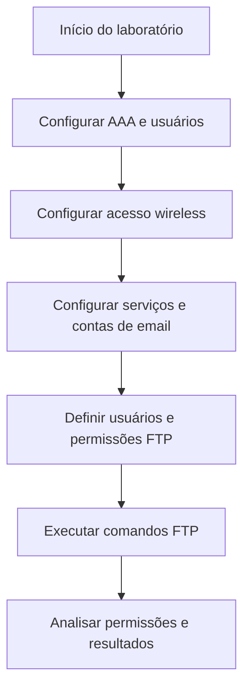

# Controle de Acesso com AAA, Email e FTP

## Visão geral

Neste laboratório educacional da **Cisco Networking Academy (NetAcad)**, utilizei o **Cisco Packet Tracer** para entender como controlar o acesso de usuários a uma rede e a diferentes serviços.

A atividade abordou autenticação wireless com AAA/RADIUS, configuração de contas de email e permissões de arquivos em um servidor FTP. O principal aprendizado foi entender que **ter acesso a um sistema não significa ter permissão para realizar todas as ações**.


---

Esta documentação apresenta as configurações registradas, as atividades previstas e os conhecimentos adquiridos durante o exercício.


---

## Objetivos

- Entender a diferença entre autenticação e autorização.
- Configurar usuários para acesso wireless com AAA/RADIUS.
- Conhecer os serviços SMTP e POP3 usados no email.
- Definir permissões de acesso a arquivos no FTP.
- Observar operações permitidas e negadas conforme o usuário.

---

## Configurações dos dispositivos

### Servidor AAA/RADIUS

| Parâmetro | Configuração registrada |
|---|---|
| Serviço AAA | Ativado |
| Protocolo | RADIUS |
| Porta | 1812 |
| Cliente cadastrado | WLC-1 |
| IP do cliente | 192.168.99.250 |
| Usuários | `user1` e `user2` |

O servidor centraliza a verificação das credenciais utilizadas para acessar a rede wireless.

---

### HQ-Laptop-1

| Parâmetro | Configuração registrada |
|---|---|
| Interface | Wireless0 |
| SSID | HQ-INT |
| Autenticação | WPA2 (802.1X) |
| Usuário | `user1` |
| Criptografia | AES |
| Endereçamento | DHCP selecionado |
| Rede prevista na atividade | 192.168.50.0/24 |

---

### HQ-Laptop-2

| Parâmetro | Configuração prevista na atividade |
|---|---|
| SSID | HQ-INT |
| Autenticação | WPA2 com credenciais AAA |
| Usuário | `user2` |
| Endereçamento | DHCP |
| Rede esperada | 192.168.50.0/24 |

---

### Servidor de email

| Parâmetro | Configuração registrada |
|---|---|
| SMTP | Ativado |
| POP3 | Ativado |
| Domínio | mail.cyberhq.com |
| Contas | `HQuser1`, `HQuser2`, `BRuser1` e `BRuser2` |

O SMTP é utilizado para enviar mensagens, enquanto o POP3 permite que um cliente de email recupere mensagens da caixa postal.

---

### Contas de email

| Usuário | Endereço | Dispositivo indicado |
|---|---|---|
| HQuser1 | HQuser1@mail.cyberhq.com | PC 1-1 |
| HQuser2 | HQuser2@mail.cyberhq.com | Conforme atividade |
| BRuser1 | BRuser1@mail.cyberhq.com | Conforme atividade |
| BRuser2 | BRuser2@mail.cyberhq.com | Conforme atividade |

A atividade também menciona os dispositivos PC 2-3, HQ-Laptop-1 e Net-Admin na configuração dos clientes de email.

---

### Servidor FTP

| Parâmetro | Configuração registrada |
|---|---|
| Serviço | FTP ativado |
| Endereço IP | 192.168.75.2 |
| Usuários | `sukyi`, `ajulo` e `malia` |

---

**Permissões dos usuários:**

| Usuário | Ler | Escrever | Excluir | Renomear | Listar |
|---|---|---|---|---|---|
| sukyi | Sim | Sim | Sim | Sim | Sim |
| ajulo | Sim | Sim | Sim | Sim | Sim |
| malia | Sim | Sim | Não | Sim | Sim |

A conta `malia` pode acessar e trabalhar com arquivos, mas não tem autorização para excluir.

---

## Etapas da atividade

1. Ativar o serviço AAA/RADIUS e cadastrar os usuários.
2. Configurar o acesso wireless nos laptops usando WPA2/802.1X e DHCP.
3. Ativar SMTP e POP3 e criar as contas de email.
4. Configurar os clientes de email e preparar mensagens.
5. Ativar o FTP e definir as permissões de cada usuário.
6. Utilizar comandos FTP para observar as operações disponíveis e as restrições de acesso.

---

## Fluxograma do processo



---

## Comandos FTP utilizados

```text
ftp 192.168.75.2
dir
get aMessage.txt
put aMessage_new.txt
delete aMessage_new.txt
rename aMessage_new.txt aMessage_rename.txt
```

---

| Comando | Para que serve? |
|---|---|
| `ftp` | Inicia uma conexão com o servidor FTP. |
| `dir` | Lista os arquivos disponíveis. |
| `get` | Baixa um arquivo do servidor. |
| `put` | Envia um arquivo ao servidor. |
| `delete` | Tenta excluir um arquivo. |
| `rename` | Tenta renomear um arquivo. |

---

## Resultados registrados

| Verificação | Observação |
|---|---|
| Conexão FTP | Conexão e autenticação apresentadas no terminal. |
| Exclusão com `malia` | Operação negada por falta de permissão. |
| Renomeação com `malia` | Operação concluída com sucesso. |
| Email | Tela de composição de mensagem registrada; não confirma o recebimento. |
| Wireless | Configuração de autenticação e DHCP registrada; não confirma a conectividade final. |

Também foi registrado um **timeout** em uma tentativa inicial de conexão FTP. O material disponível não confirma a causa desse comportamento.

---

## Conhecimentos adquiridos

O laboratório me ajudou a entender duas etapas importantes do controle de acesso:

- **Autenticação:** verifica quem está tentando entrar, por exemplo, com usuário e senha.
- **Autorização:** determina o que essa pessoa pode fazer após acessar o serviço.

O exemplo do FTP tornou essa diferença mais clara: a conta `malia` conseguiu realizar uma operação de renomeação, mas não tinha permissão para excluir arquivos.

Esse aprendizado é útil em **Suporte de TI e IAM**, especialmente ao investigar situações em que um usuário consegue entrar em um sistema, mas não pode executar determinada tarefa.

---

## Entendendo os termos técnicos

| Termo | Explicação simples |
|---|---|
| AAA | Conjunto de funções para verificar usuários, controlar permissões e registrar informações de acesso. |
| RADIUS | Protocolo usado para verificar credenciais de acesso à rede em um servidor central. |
| WPA2/802.1X | Tecnologias usadas para proteger a rede wireless e autenticar quem tenta se conectar. |
| DHCP | Serviço que fornece automaticamente configurações de rede, como endereço IP. |
| SMTP | Protocolo usado para enviar emails. |
| POP3 | Protocolo usado para recuperar emails de uma caixa postal. |
| FTP | Protocolo para transferir arquivos entre dispositivos e um servidor. |
| Permissão | Regra que define quais ações um usuário pode realizar. |

---

## Onde esse conhecimento pode ser aplicado?

### Cenário fictício: acesso a arquivos de uma empresa

**Situação:** uma empresa possui uma pasta de arquivos compartilhados. Os funcionários precisam consultar e atualizar documentos, mas somente alguns devem poder excluí-los.

**Aplicação:** a equipe de TI configura contas e permissões diferentes. Assim, um funcionário pode acessar os arquivos e realizar determinadas alterações, sem ter autorização para apagar documentos.

**Relação com o laboratório:** o exemplo representa o controle de permissões estudado no FTP e ajuda a entender por que uma conta pode funcionar normalmente mesmo quando uma ação específica é bloqueada.


